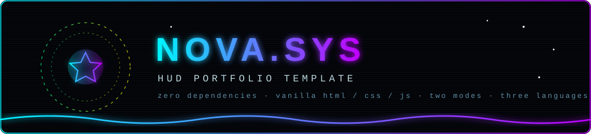
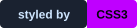
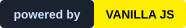
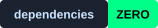
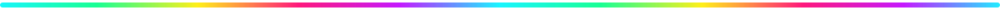

<div align="center">




<br>







</div>



# 🛰️ NOVA.SYS — HUD Portfolio Template

An interactive, **sci-fi HUD-style personal portfolio** that runs as a static site — no build step, no frameworks, no backend. The interface is a spaceship: boot it up, calibrate the audio, and navigate a glowing **node tree** of your life. Feeling brave? Switch to the **Pro Mode** cockpit and fly through your projects at warp speed.

> ✅ **Just HTML + CSS + JS.** Drag the folder onto GitHub, flip on Pages, and your portfolio is live. That's the whole deployment pipeline.


## ✨ Feature Manifest

| 🎯 Feature                        | 📖 Details                                                                                                                                                                                                 |
| --------------------------------- | ---------------------------------------------------------------------------------------------------------------------------------------------------------------------------------------------------------- |
| 🖥 **Two experiences**            | **Default Mode** — interactive SVG node tree with pan & zoom camera · **Pro Mode** — pseudo-3D cockpit with warp starfield, floating pods and console overlays                                             |
| 🚀 **Cinematic boot screen**      | Typed terminal log, progress bar, sweeping meteor, **audio calibration panel** with a volume test sweep, language pre-select and a `SKIP ▸` mercy button                                                   |
| 🌳 **Node tree navigation**       | Root avatar → section nodes → child files, animated edge drawing, glowing halos, breadcrumb HUD (`MAIN TREE / PROJECTS / …`) and a `◄ GO BACK` button                                                      |
| 🛸 **Hologram panels**            | Content opens in a scanlined holographic panel with a glitch-in animation — text stays selectable and copyable                                                                                             |
| 🎛 **Generative audio engine**    | Zero audio files. A Web-Audio synth plays three ambient tracks (**DEEP FIELD · ION RAIN · PULSAR DRIFT**) with play/pause/prev/next, loop progress and seek bar — plus tiny UI blips for every interaction |
| 🎚 **Segmented volume widgets**   | Retro block-meter volume control on the boot screen _and_ in the top-left HUD, fully draggable & keyboard accessible                                                                                       |
| 🖱 **Custom cursor trio**         | Dot + lerp ring + glowing splash trail, context-aware growth over interactive elements                                                                                                                     |
| 🌌 **Three living canvas layers** | Perspective grid that scrolls toward you, constellation particles that link to your cursor, and a fading neon cursor trail — each **toggleable** from the toolbar                                          |
| 🌍 **Trilingual**                 | English 🇬🇧 · Türkçe 🇹🇷 · Deutsch 🇩🇪 — one-click switch, remembered in `localStorage`, including the whole node tree and panel content                                                                      |
| 📱 **Fully responsive**           | Bottom-sheet panels on mobile, touch-friendly pods, adaptive camera zoom, coarse-pointer fallbacks                                                                                                         |
| ♿ **Built-in accessibility**     | Semantic screen-reader summary, skip links, ARIA roles/labels on the tree and sliders, keyboard navigation (`Tab` / `Enter` / `Esc` / arrows), `prefers-reduced-motion` support                            |
| 🔍 **SEO ready**                  | Open Graph + Twitter cards, JSON-LD `Person` schema, canonical link, social cover image included                                                                                                           |


## 🖥 The Two Modes

### 1️⃣ Default Mode — _"The Node Tree"_


A full-screen SVG constellation is your sitemap. Click a node to zoom the camera in, expand child files, and open holographic dossier panels. Wheel to zoom, drag to pan, `Esc` to climb back up.

### 2️⃣ Pro Mode — _"The Cockpit"_ (`/pro-mode/`)

- ☄️ **Warp starfield** on canvas with a speed slider (`WARP 1–10`)
- 🛰 **Five floating pods** (About · Projects · Skills · Hobbies · Contact) drifting in pseudo-3D space with mouse parallax
- 🕹 **Keyboard flight:** `◄ ►` select pod · `Enter` open · `Esc` close/eject
- 🖥 Console overlays, amber HUD, targeting reticle, occasional planets — same content, different spaceship


## 🚀 Quick Start (local preview — 30 seconds)

**Option A — Python (any OS):**

```bash
cd portfolio
python3 -m http.server 8000
# open http://localhost:8000
```

**Option B — VS Code:** install the **Live Server** extension → right-click `index.html` → _Open with Live Server_.

**Option C — Double-click `index.html`.** It mostly works str aight from disk since there are no fetches — but a local server is recommended for correct fonts and paths.

> 💡 The generative music starts only after you press ▶ in the top-left player (browsers require a user gesture for audio — the boot calibration sets the volume).


## 📂 Project Structure

```
portfolio/
├── index.html              ← Default Mode (node tree)
├── styles.css              ← design system + every animation
├── script.js               ← boot · audio synth · canvases · tree · panels · i18n
├── pro-mode/
│   ├── index.html          ← Pro Mode cockpit page
│   ├── pro.css             ← amber cockpit theme
│   └── pro.js              ← warp starfield + pods + console
├── assets/                 ← images (avatar, meteor, og cover, 6 project artworks)
├── readme-assets/          ← animated SVGs used by this README
├── README.md               ← you are here
├── .gitignore
└── LICENSE                 ← MIT — make it yours
```

**Total: 25 files ~ 0.8 MB** — comfortably under GitHub's 100-file drag-and-drop limit. ✅


## 🛠 Make It Yours (5-minute customization)

Everything content-related lives in **one place** — no hunting through markup:

| ✏️ To change…           | 🔎 Where                                                             | 💡 Hint                                           |
| ----------------------- | -------------------------------------------------------------------- | ------------------------------------------------- |
| **Your name / tagline** | `script.js` → search `AYAAN MALIK` & `hero.sub`                      | also update `<title>` + meta tags in `index.html` |
| **Intro paragraphs**    | `I18N` object in `script.js` → keys `about.p1–p3`                    | per language: `en` / `tr` / `de`                  |
| **Projects (6)**        | `PROJECTS` array in `script.js`                                      | swap title, tags, description, image path & link  |
| **Skill bars**          | `SKILL_FIELDS` array in `script.js`                                  | `['Python', 90]` = label + percent                |
| **Education list**      | `Holo.profile()` in `script.js`                                      | edit the `edu.*` strings per language             |
| **Social links**        | search `github.com/` & `linkedin.com/` in `index.html` + `script.js` | replace with your profiles                        |
| **Email**               | `Holo.contact()` + JSON-LD in `index.html`                           | one place each                                    |
| **Accent colors**       | `:root` block at the top of `styles.css`                             | `--cyan`, `--pink`, `--yellow`…                   |
| **Music moods**         | `TRACKS` array in `script.js`                                        | chord numbers are semitone offsets                |
| **Avatar & artworks**   | `assets/`                                                            | keep the same filenames → zero code changes       |

> 🗣 **Adding a 4th language:** copy one block inside `I18N`, translate the strings, add a `<button class="tb-lang" data-lang="xx">`. Done.


## 🌍 Compatibility & Accessibility

| ✅       | Detail                                                            |
| -------- | ----------------------------------------------------------------- |
| Browsers | Chrome, Edge, Firefox, Safari (current + previous major)          |
| Mobile   | iOS Safari, Chrome on Android — panels become bottom sheets       |
| Motion   | Respects `prefers-reduced-motion` (calms the whole universe down) |
| Keyboard | Full navigation without a mouse — `Tab`, `Enter`, `Esc`, arrows   |
| Readers  | Semantic summary of all content for screen readers & SEO crawlers |


## 📄 License

Released under the **MIT License** — see [`LICENSE`](LICENSE). Fork it, restyle it, launch it as your own. A ⭐ on the repo is the nicest thank-you.

> 🎨 All artwork in `assets/` and `readme-assets/` was generated for this template and ships with it. The sample persona **"Ayaan Malik / NOVA"** is fictional — replace it with _you_.

<div align="center">
<br>
<b>◈ NOVA.SYS</b> — build the weird thing. then make it useful.
<br><br>

<sub>crafted with vanilla HTML · CSS · JS — zero frameworks were harmed</sub>
</div>

<div align="center">
## 🌟 Support the Project

If you find this template useful, please consider giving it a star! It helps others discover the repository and supports future development.

</div>


